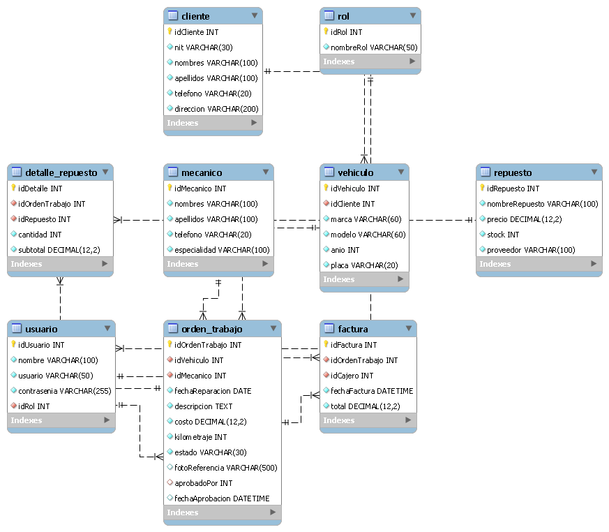

 AutoFix - Control de Taller Mecánico

Autor: Miguel Guzman  
Curso:Taller I  
Sección: IN4CM  
Institución: Fundación Kinal
Descripción

AutoFix es un sistema desarrollado en Java para administrar un taller mecánico. Permite iniciar sesión, gestionar mecánicos, registrar reparaciones de vehículos y aprobar la calidad de los trabajos realizados.
 Tecnologías utilizadas
- Java JDK 21
- Apache NetBeans 29
- JavaFX
- MySQL 8.0
- MySQL Workbench
- Git y GitHub

 Arquitectura del proyecto

El sistema utiliza el patrón MVC y DAO para organizar el código.

- Model: contiene las clases que representan los datos.
- View: contiene las interfaces gráficas FXML.
- Controller: controla las acciones de las ventanas.
- DAO: permite comunicarse con MySQL mediante procedimientos almacenados.
- SessionContext: administra la sesión del usuario.

 Requisitos
Para ejecutar el proyecto se necesita:
1. Tener instalado Java JDK 21.
2. Tener instalado Apache NetBeans.
3. Tener configurado JavaFX.
4. Tener instalado MySQL 8.0.
5. Tener acceso a la base de datos del proyecto.

 Configuración de MySQL
1. Abrir MySQL Workbench.
2. Importar el respaldo ubicado en `database/db_autofix_respaldo.sql`.
3. Comprobar que exista la base de datos `db_autofix`.
4. Revisar la configuración de conexión en `Conexion.java`.
5. Iniciar el servidor MySQL antes de ejecutar el programa.

 Credenciales de MySQL
- Servidor: localhost
- Puerto: 3306
- Usuario por defecto: root
- Contraseña: la configurada durante la instalación de MySQL.
- Base de datos: db_autofix

 Cómo ejecutar el proyecto
1. Abrir Apache NetBeans.
2. Seleccionar File > Open Project
3. Abrir la carpeta del proyecto AutoFix.
4. Verificar que JavaFX y MySQL Connector/J estén configurados.
5. Ejecutar Clean and Build.
6. Ejecutar el proyecto.
7. Iniciar sesión con un usuario registrado en MySQL.

Funciones principales
- Inicio y cierre de sesión.
- Control de acceso según el rol del usuario.
- Administración de mecánicos.
- Registro de reparaciones.
- Registro del kilometraje del vehículo.
- Aprobación de calidad por el Jefe de Taller.
- Conexión a MySQL mediante procedimientos almacenados.

Base de datos
La base de datos utilizada es `db_autofix`.
Contiene información sobre clientes, vehículos, mecánicos, usuarios, roles, órdenes de trabajo y repuestos.
El respaldo SQL se encuentra en la carpeta `database`.

 Diagrama entidad-relación
El diagrama entidad-relación de AutoFix fue generado utilizando MySQL Workbench. Contiene las 9 tablas de la base de datos y sus relaciones.
Los archivos se encuentran en la carpeta `database`:

- AutoFix_Diagrama_ER.png: imagen del diagrama para visualizarlo.
- AutoFix_Diagrama_ER.mwb: modelo editable en MySQL Workbench.

 Control de versiones
El proyecto utiliza GitFlow para organizar el desarrollo mediante las ramas `master`, `develop` y `feature`.

Repositorio: https://github.com/MiguelGuzman502/AutoFix-MiguelGuzman
Videos de presentación del proyecto AutoFix

A continuación se presentan tres videos donde se explica el desarrollo, la base de datos y el funcionamiento del sistema AutoFix.

Video 1 — Código Java, arquitectura y GitHub

En este video se explican las tecnologías utilizadas, la estructura del proyecto, las clases Java, la arquitectura MVC, el patrón DAO, Singleton y el repositorio de GitHub.

🔗 https://youtu.be/7fVb8t5uvb4

Video 2 — Base de datos MySQL

En este video se muestra la base de datos db_autofix, sus tablas, registros, procedimientos almacenados y el diagrama entidad-relación.

🔗 https://youtu.be/-s9BCw1Z368

Video 3 — Funcionamiento de AutoFix

En este video se demuestra el funcionamiento del sistema, incluyendo el inicio de sesión, la administración de mecánicos, el registro de reparaciones, la aprobación de calidad y el control de acceso por roles.

🔗 https://youtu.be/_EQ6Iu5w_0g

 Autor
Miguel Guzman  
Fundación Kinal - IN4CM
